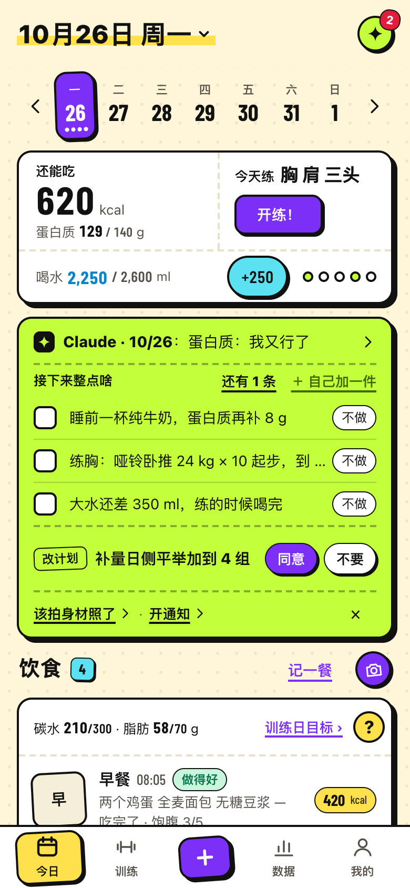
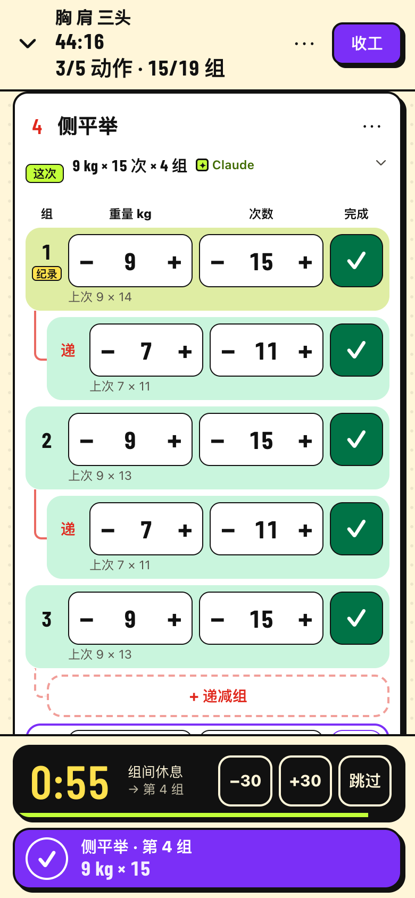
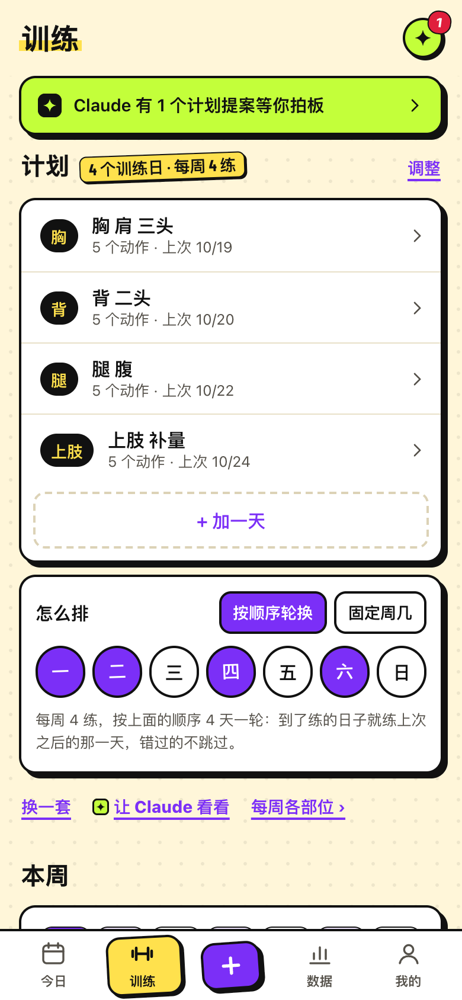
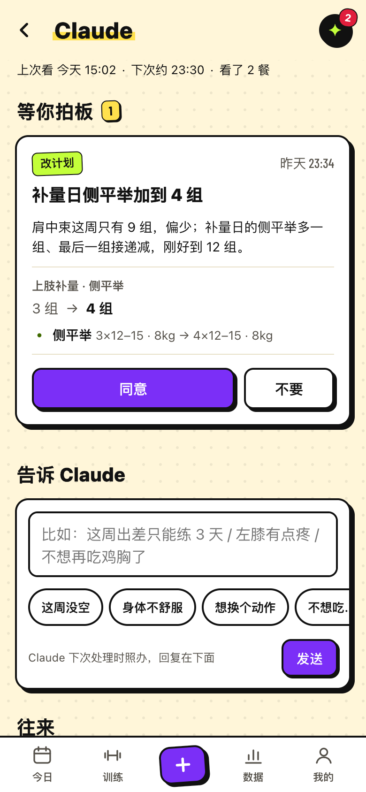
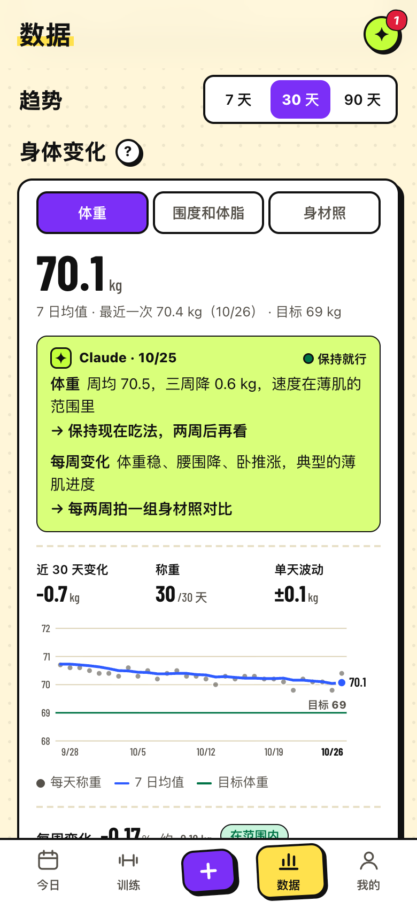

<p></p>

# 薄肌研究所 (Boji Lab)

[中文](README.md)

A self-hosted food and training log for your phone, with the analysis done by Claude Code on your own computer. The interface is in Chinese.

You photograph meals before and after eating, log sets and reps, and weigh yourself in a mobile web page; the server only stores it. Claude Code on your computer acts as your personal coach: on a schedule (or whenever you ask) it runs `/fitness-review`, pulls the new records, estimates calories and macros from the photos, reviews workouts and suggests the next weights, writes daily and weekly reports, does what you asked it to in your notes, adjusts the plan within the authority you gave it, and writes everything back.

```
 phone browser ──records, photos──▶  your server (app/server.py)  ◀──read / write back──  Claude Code on your computer
                ◀──feedback───────   SQLite + photo folder                                 (bin/lsj, .claude/skills)
 iPhone Shortcut ──Apple Health (sleep, steps, energy, resting HR, HRV, weight, body fat, workout heart rate), upload-only──▶ server
```

- The server never calls a model API. Its only outbound connections are the optional 训记 buttons (「从训记同步」 sync, 「写进训记」 write templates). Python standard library only, no build step
- A Claude tab is the coach's home: plan proposals you accept or decline with one tap, 训记 templates to approve, questions, notes you leave for Claude (answered on its next run), a log of what it did (its small self-made adjustments can be undone), and what it remembers about you (editable). You choose whether it may make small adjustments on its own or must ask first
- The user stays in control: targets, the training plan, the quick-add list, a meal's calories, synced sleep/weight and "don't count this day" are all editable on the page, and Claude suggests instead of overwriting. A 数据 (data) tab shows sleep, weight, gain/loss rate, resting HR and HRV, activity, diet and training with 7/30/90-day trends, per-exercise progress, a one-page weekly comparison and Claude's one-line take on each card
- Goals include 薄肌 (lean and defined rather than bulky), and the Today page has a 「五件套」 row (2 L of water, 8 h of sleep, protein target, 8,000 steps, training done) worked out from what's already logged
- Processing is offline and batched, one account at a time; several people can share one server

<p>





</p>

Today · live workout · training plan · Claude · data (a demo account with made-up data)

## Privacy

- **Photos and records are sent to Anthropic when Claude Code processes them.**
- **The CLI token (`LSJ_TOKEN`) reads and writes every account's data.** Whoever runs Claude Code sees everyone's records and photos. It cannot manage accounts.
- Admins can't see other people's records in the web UI, but that is not a privacy boundary: an admin can reset someone's password and log in as them, and root on the server sees everything.
- Apple Health upload tokens can only upload; the database stores their hashes.
- The 「同步健康」 Shortcut also sends the last two days of heart rate and active energy samples (with each sample's source device) on every sync. The server only uses them to work out average, maximum and minimum heart rate and energy burned for each workout logged in 训练中, keeps those numbers, and does not store the samples.

See [SECURITY.md](SECURITY.md).

## Quick start

```sh
# try it locally (Python 3.9+, no dependencies)
LSJ_TOKEN=dev-token LSJ_PASSWORD=dev-password LSJ_DATA=./data LSJ_COOKIE_SECURE=0 python3 app/server.py
# open http://127.0.0.1:8780 and log in as admin / dev-password
```

- Deploy: [deploy/README.md](deploy/README.md) (systemd + nginx, or Docker Compose with Caddy); settings in [.env.example](.env.example)
- Claude Code: write `~/.config/lianshiji/config.json` from [docs/config.example.json](docs/config.example.json), check with `bin/lsj users`, then run `/fitness-plan` and `/fitness-review` in this folder. Owner-only notes go in `CLAUDE.local.md` (gitignored). To run it on a schedule, use `scripts/auto-review.sh` with launchd ([deploy/auto-review.plist.example](deploy/auto-review.plist.example)); scheduled runs never change the plan directly, they leave proposals
- iPhone Shortcut: `deploy/make-shortcut.py https://your-domain` on a Mac signed into iCloud, then `deploy/deploy.sh`
- Optional 训记 (Xunji) workout-app import: unofficial, needs your own 训记 API keys; see the 训记 section of [CLAUDE.md](CLAUDE.md). Storing your read-only training key on the server enables the in-page sync button, and storing the template key (it can only change 训记's 「Agent 模版」 folder) lets you write Claude's prepared templates into 训记 from the page after reviewing them; the sample systemd unit then needs its two `IPAddress*` lines removed

## Development

`python3 -m unittest discover -s tests -v`, `ruff check .`, `scripts/check-secrets.sh`. See [CONTRIBUTING.md](CONTRIBUTING.md).

`lsj` and `lianshiji` in the code, commands and paths come from the project's earlier name, 练食记 (Lianshiji). 薄肌研究所 reads "bó jī yán jiū suǒ", roughly "lean muscle lab".

## License

[MIT](LICENSE). The Barlow Condensed font is under the SIL Open Font License 1.1 ([app/web/fonts/OFL.txt](app/web/fonts/OFL.txt)).
